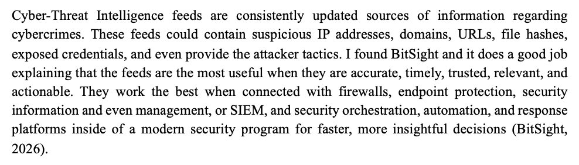
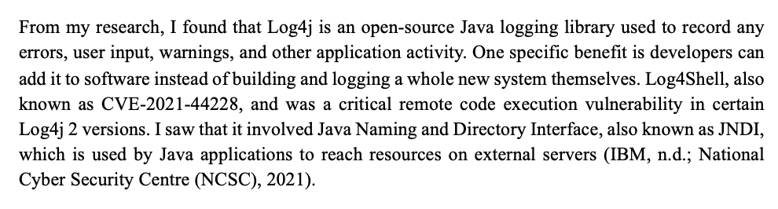
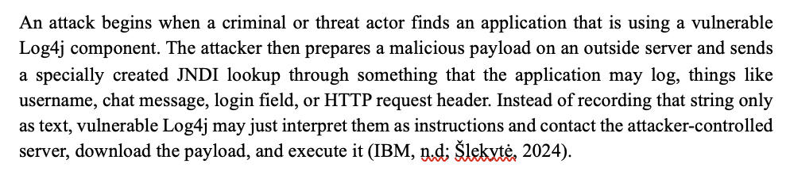
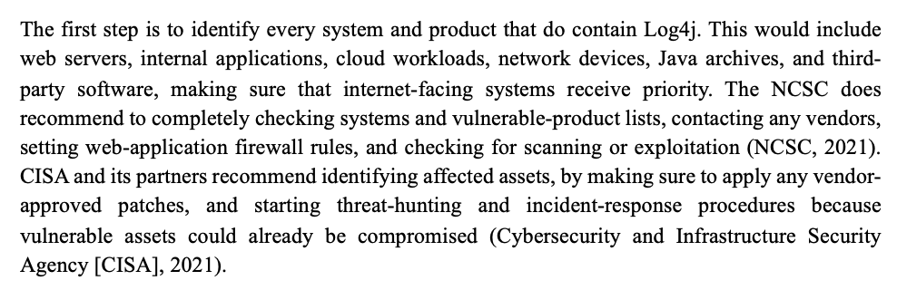
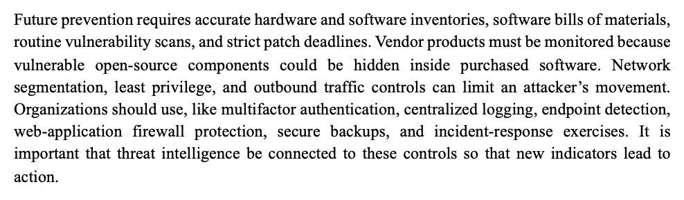

# Threat Intelligence & Log4Shell Vulnerability Analysis

## Project Overview

This project examined cyber-threat intelligence feeds and the Log4Shell vulnerability, also known as CVE-2021-44228.

The research focused on how threat intelligence supports security operations, how Log4Shell can be exploited, how an attempted attack can become a confirmed compromise, what organizational damage may result, and how security teams can respond, investigate, remediate, and prevent similar incidents.

The project also explored how threat intelligence can support tools and controls such as SIEM platforms, firewalls, endpoint protection, vulnerability management, and incident-response processes.

## Objectives

- Explain the purpose of cyber-threat intelligence feeds.
- Identify common threat-intelligence sources and indicators.
- Evaluate the importance of accurate and actionable intelligence.
- Analyze Log4Shell / CVE-2021-44228.
- Explain the role of JNDI in Log4Shell exploitation.
- Document the progression of a Log4Shell attack.
- Distinguish an attempted exploit from a confirmed breach.
- Evaluate organizational impact.
- Identify remediation and incident-response actions.
- Examine threat-hunting data sources and warning signs.
- Recommend long-term preventive security controls.

## Cyber-Threat Intelligence

Cyber-threat intelligence feeds provide continuously updated information about malicious activity and indicators that may be relevant to an organization.

Common intelligence can include:

- Suspicious IP addresses
- Malicious domains
- URLs
- File hashes
- Exposed credentials
- Attacker tactics

Threat intelligence is most useful when the information is accurate, timely, trusted, relevant, and actionable.

*Cyber-threat intelligence feed overview describing common indicators and the importance of timely, trusted, relevant, and actionable intelligence integrated with security controls.*

Threat intelligence can support technologies such as:

- Firewalls
- Endpoint protection
- SIEM platforms
- Security orchestration and automation
- Incident-response processes

The project also examined threat-intelligence sources such as Google Threat Intelligence, VirusTotal, AlienVault OTX, AbuseIPDB, abuse.ch, FireHOL blocklists, and Shodan.

## Threat Intelligence Analysis

Threat feeds should not be treated as automatic evidence that an indicator is malicious.

Indicators should be evaluated and correlated with the organization's environment before action is taken.

For example, intelligence about exposed credentials could lead an organization to:

- Reset affected passwords.
- Revoke active sessions.
- Review accounts for suspicious activity.

Information from Shodan may help identify exposed systems or services, while other threat-intelligence sources can provide additional context about malicious activity.

Older or poorly supported indicators should be reviewed carefully before being automatically blocked.

## Log4Shell Vulnerability

Log4j is an open-source Java logging library used by applications to record events such as errors, warnings, user input, and other application activity.

Log4Shell, identified as **CVE-2021-44228**, was a critical remote code execution vulnerability affecting certain Log4j 2 versions.

The vulnerability involved Java Naming and Directory Interface, or **JNDI**, which Java applications can use to reach external resources.

*Log4Shell vulnerability overview identifying CVE-2021-44228 as a critical remote code execution issue in certain Log4j 2 versions and explaining the role of JNDI.*

## Attack Progression

A Log4Shell attack can begin when a threat actor identifies an application using a vulnerable Log4j component.

The attacker may host a malicious payload on an external system and then submit a specially crafted JNDI lookup through data that the vulnerable application records.

Possible input locations include:

- Usernames
- Chat messages
- Login fields
- HTTP request headers

Instead of treating the malicious string only as text, vulnerable Log4j may interpret it as an instruction.

This can cause the application to:

1. Process the malicious JNDI lookup.
2. Contact an attacker-controlled server.
3. Retrieve a malicious payload.
4. Execute attacker-controlled code.

*Log4Shell attack progression showing how a crafted JNDI lookup can cause vulnerable Log4j components to contact an attacker-controlled server, retrieve a payload, and execute malicious code.*

## Attempted Exploit vs. Confirmed Breach

An attempted malicious request does not automatically prove that a system has been breached.

A more serious compromise occurs when the vulnerable system follows the unauthorized lookup and executes attacker-controlled code.

After successful exploitation, an attacker may:

- Install malware
- Steal credentials
- Create a backdoor
- Move laterally through the environment
- Steal sensitive information
- Establish persistence

The incident may continue even after the original connection ends because stolen credentials or persistence mechanisms can allow the attacker to regain access.

## Organizational Impact

A successful Log4Shell compromise can affect all three elements of the CIA triad.

### Confidentiality

Attackers may obtain:

- Customer information
- Employee records
- Passwords
- Financial data
- Intellectual property
- Tokens
- Encryption keys

### Integrity

Attackers may:

- Modify files
- Change system settings
- Alter security controls
- Create unauthorized accounts
- Establish persistence

### Availability

Attackers may:

- Interrupt services
- Encrypt data
- Cause operational downtime
- Use compromised systems to attack other resources

Potential business consequences include:

- Lost revenue
- Recovery costs
- Legal reporting obligations
- Regulatory penalties
- Damage to customer trust

## Remediation and Incident Response

The response process begins with identifying systems and products that may contain vulnerable Log4j components.

Affected assets can include:

- Web servers
- Internal applications
- Cloud workloads
- Network devices
- Java archives
- Third-party applications

Internet-facing systems should receive priority because they may have greater exposure.

*Log4Shell remediation and incident-response guidance focused on asset identification, vendor-approved patching, WAF protections, exploitation checks, threat hunting, and response procedures.*

Recommended response actions include:

- Identify affected assets.
- Review vulnerable-product information.
- Contact vendors when necessary.
- Apply vendor-approved patches.
- Configure appropriate web-application firewall rules.
- Check for scanning or exploitation attempts.
- Begin threat-hunting procedures.
- Initiate incident response if compromise is suspected.

## Containment and Recovery

Patching the vulnerability is important, but patching alone does not remove an attacker who has already compromised the system.

Suspected systems should be isolated while evidence is preserved.

Security teams should investigate and remove:

- Malware
- Web shells
- Unauthorized accounts
- Scheduled tasks
- Other persistence mechanisms

Potentially exposed credentials should also be replaced, including:

- Passwords
- Tokens
- API keys
- Certificates

A system that cannot be trusted may need to be rebuilt from a known-good image or restored from a trusted backup.

## Threat Hunting

Investigators may need to examine multiple sources of security data when evaluating possible Log4Shell exploitation.

Relevant evidence can include:

- Log4j logs
- Application logs
- Web-server logs
- Reverse-proxy records
- Web-application firewall alerts
- Firewall traffic
- DNS requests
- Cloud audit trails
- Authentication logs
- Endpoint-detection data

Potential warning signs include:

- JNDI strings
- Unexpected outbound LDAP connections
- Unexpected outbound DNS activity
- Java launching PowerShell
- Java launching Bash
- Unusual downloads
- New user accounts
- Privilege changes
- Scheduled tasks
- Web shells
- Suspicious file changes

Additional resources such as software dependencies, vulnerability scans, asset inventories, vendor advisories, backups, certificates, and stored secrets should also be reviewed.

## Long-Term Prevention

Preventing future incidents requires more than patching one vulnerability.

Organizations should maintain accurate hardware and software inventories and understand which components exist within their environments.

*Long-term Log4Shell prevention strategy using asset inventories, SBOMs, vulnerability scanning, patch management, segmentation, least privilege, MFA, centralized logging, endpoint detection, WAF protection, backups, and incident-response exercises.*

Recommended preventive controls include:

- Hardware inventories
- Software inventories
- Software Bills of Materials (SBOMs)
- Routine vulnerability scanning
- Defined patching deadlines
- Vendor monitoring
- Network segmentation
- Least privilege
- Outbound traffic controls
- Multifactor authentication
- Centralized logging
- Endpoint detection
- Web-application firewall protection
- Secure backups
- Incident-response exercises

Threat intelligence should be connected to these controls so that new indicators can lead to meaningful defensive action.

## Security Lessons

This project demonstrated that vulnerability management, threat intelligence, and incident response are closely connected.

An organization must understand what assets it owns, what software those assets contain, and whether vulnerable third-party components are present.

The project also reinforced that:

- A patch does not automatically prove that a previously vulnerable system is clean.
- Threat hunting is necessary when exploitation may have occurred.
- Intelligence should be correlated with internal security data.
- Asset inventories are critical during vulnerability response.
- Security teams need visibility across network, endpoint, application, and cloud logs.
- Layered security controls can reduce both the likelihood and impact of compromise.

## Skills Demonstrated

- Cyber-Threat Intelligence
- CVE Research
- Vulnerability Analysis
- Log4Shell / CVE-2021-44228 Analysis
- Remote Code Execution Concepts
- Threat Hunting
- Incident Response
- Vulnerability Remediation
- Asset Identification
- Patch Management
- Log Analysis Concepts
- SIEM Concepts
- Network Security
- Endpoint Security
- Cloud Security
- Risk Assessment
- Security Research
- Technical Documentation

## Project Evidence

This repository includes selected screenshots from the completed research assignment demonstrating the major components of the analysis.

The complete project also examined threat-intelligence sources, breach conditions, organizational impact, incident investigation, remediation, future security controls, and emerging cyber threats.

## Disclaimer

This project was completed as part of an authorized academic cybersecurity exercise.

The analysis was conducted for educational purposes using publicly documented vulnerabilities, threat-intelligence resources, and security guidance. No unauthorized systems were accessed or tested.